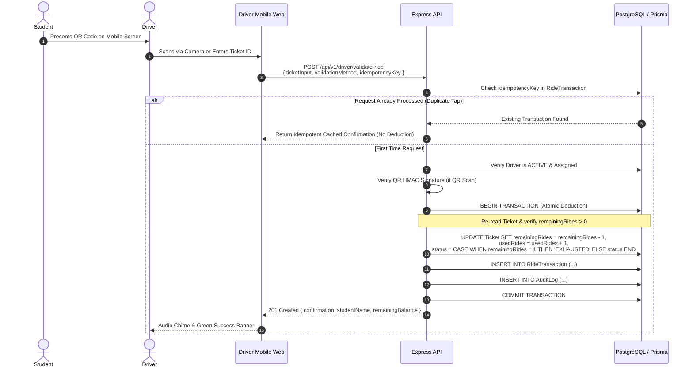

# Campus Keke Ticket Management System — System Architecture

## 1. High-Level Architecture Overview

The **Campus Keke Ticket Management System** is a mission-critical, role-enforced transit management platform designed for campus tricycle (keke) transit operations. It ensures that ride credits cannot be forged, bypassed, or duplicated, maintaining strict single-source-of-truth semantics on the backend database.

```
┌────────────────────────────────────────────────────────────────────────┐
│                              FRONTEND                                  │
│                 (Next.js 14 App Router + Tailwind CSS)                 │
├────────────────────┬────────────────────┬──────────────────────────────┤
│  Student Interface │  Driver Interface  │      Admin Dashboard         │
│  - View Ticket     │  - QR Scanner      │  - Analytics & Real Stats    │
│  - Display QR Code │  - Manual Fallback │  - Offline Sales (POS/Cash)  │
│  - Balance Monitor │  - Emergency Credit│  - Refills & Reactivations   │
│  - Trip History    │  - Daily Counters  │  - Driver & Keke Fleet       │
└─────────┬──────────┴─────────┬──────────┴──────────────┬───────────────┘
          │ (HTTPS / JSON)     │                         │
          ▼                    ▼                         ▼
┌────────────────────────────────────────────────────────────────────────┐
│                        BACKEND API SERVICE                             │
│                     (Node.js + Express REST API)                       │
├────────────────────────────────────────────────────────────────────────┤
│  Middleware Layer:                                                     │
│   • Helmet Security Headers                                            │
│   • CORS with Origin Restrictions                                      │
│   • Rate Limiting (General, Auth, & Ticket ID Enumeration Defense)     │
│   • JWT Authentication (Access + Refresh Token Rotation)               │
│   • Strict Backend Role-Based Access Control (RBAC: ADMIN/DRIVER/STUD) │
│   • Zod Schema Request Validation                                      │
│   • Structured Operational Error Handling                              │
├────────────────────────────────────────────────────────────────────────┤
│  Core Services:                                                        │
│   • AuthService: Ticket-verified student onboarding & unified login    │
│   • TicketService: Cryptographic QR minting, offline sales, refills    │
│   • RideService: Concurrency-safe atomic ride deductions & idempotency │
│   • AdminService: Fleet management, audit trails, real analytics       │
└───────────────────────────────────┬────────────────────────────────────┘
                                    │ Prisma ORM
                                    ▼
┌────────────────────────────────────────────────────────────────────────┐
│                         RELATIONAL DATABASE                            │
│               (PostgreSQL in Production / SQLite in Local Dev)         │
│  - ACID Transactions with Row Locking & State Guard Constraints        │
│  - Immutable RideTransaction Ledger & Tamper-Evident Audit Logs        │
└────────────────────────────────────────────────────────────────────────┘
```

---

## 2. Core User Flows & Security Guarantees

### Flow A: Ticket-Verified Student Registration
A fundamental business constraint: **A student cannot register or create an account without purchasing an official ticket from an admin first.**

1. **Admin Issues Ticket**: Admin sells an unassigned ticket (recording buyer name, cash/transfer/POS, and amount). The ticket is minted with a high-entropy Ticket ID (e.g. `CKK-2026-F89A-4E2B`) and a cryptographically signed QR payload.
2. **Student Receives Ticket**: The student receives the physical receipt or digital Ticket ID.
3. **Student Registration**: Student inputs their Registration Number, Full Name, Phone, Password, and Ticket ID.
4. **Backend Validation**:
   - Checks if student registration number or phone is already taken.
   - Looks up ticket by Ticket ID.
   - Asserts ticket status is `UNASSIGNED`, ticket type is `STUDENT`, and `studentId` is `null`.
   - Rejects if remaining rides $\le 0$.
5. **Atomic Account Binding**: Within a single database transaction:
   - Creates the `User` account with hashed password (Argon2 / bcrypt with 12 rounds).
   - Creates the `Student` profile.
   - Binds `ticket.studentId = student.id` and updates `ticket.status = 'ACTIVE'`.
6. **Subsequent Logins**: For all future logins, the student authenticates using their Registration Number and password. The Ticket ID is **never required again** for login.

---

### Flow B: Concurrency-Safe, Atomic Ride Deduction
Every boarding validation consumes exactly 1 ride. The system guards against:
- Duplicate double-tap scans (via client `Idempotency-Key`).
- Race conditions / concurrent scans across multiple drivers (via atomic database transactions).
- Counterfeit QR codes (via HMAC-SHA256 digital signatures).



---

### Flow C: Ticket Exhaustion and Refill Life-Cycle
1. When remaining rides reach 0, the ticket transitions to `EXHAUSTED` (it is **never deleted**).
2. The student visits any campus transportation desk.
3. The Admin opens the **Ticket Refill Desk**, selects the student's Ticket ID, records payment (Cash, Transfer, POS), and adds ride credits (e.g. +10 rides).
4. The backend atomically:
   - Increments `totalRides` and `remainingRides`.
   - Transitions `status` back to `ACTIVE`.
   - Inserts a permanent audit record into `TicketRefill`.
5. The student's existing QR code and account are reactivated instantly with zero re-registration needed.

---

### Flow D: Driver Emergency Ticket Credit Fallback
If an eligible student has forgotten their phone, or their ticket is exhausted mid-commute, authorized drivers possess an admin-issued Emergency Ticket.
- When toggled, the ride deduction is funded directly from the driver's emergency balance.
- The `RideTransaction` explicitly records `rideSource: 'DRIVER_EMERGENCY_TICKET'`.
- System administrators can audit and account for emergency credits at any time.
