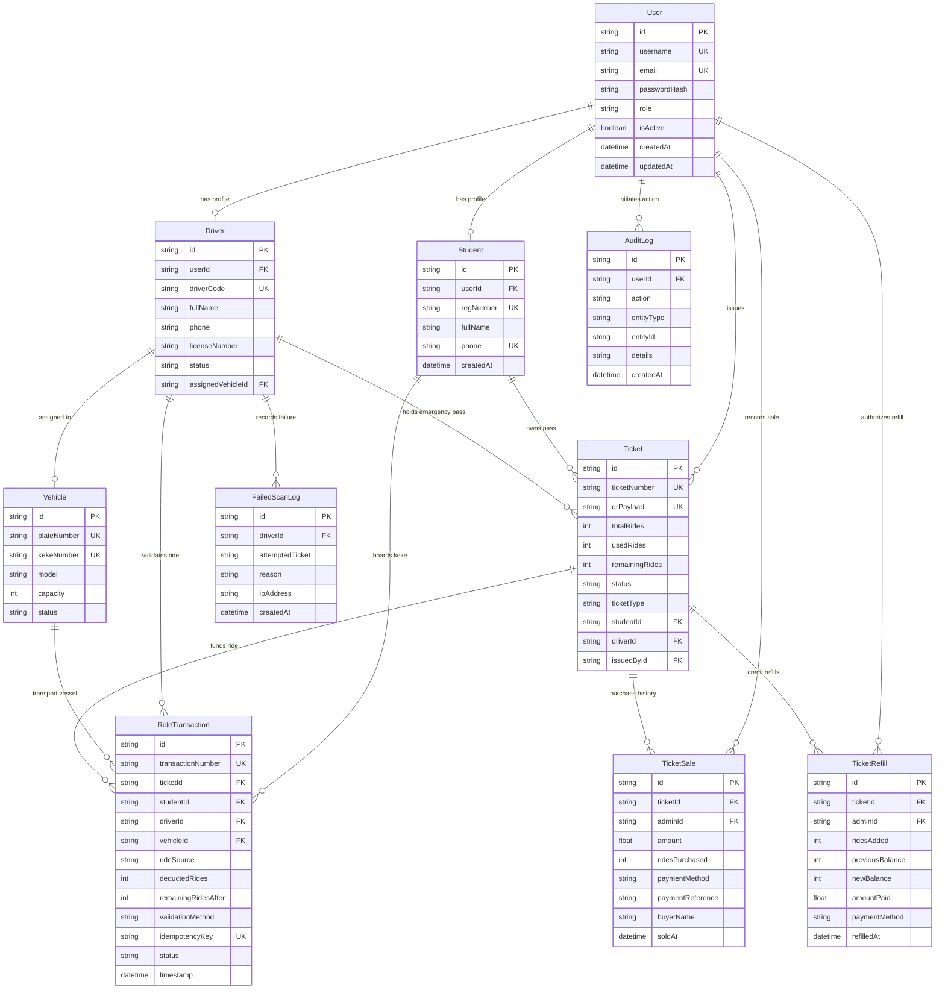

# Campus Keke Database Architecture & Entity-Relationship Model

## 1. Entity-Relationship Diagram (ERD)

---

## 2. Table Specifications & Constraints

### `User`
- `id`: UUID Primary Key.
- `username`: Unique, case-insensitive identifier (Student Reg Number, Driver Code, or Admin Username).
- `role`: Strict Enum representation (`ADMIN`, `DRIVER`, `STUDENT`).
- `isActive`: Boolean flag; deactivated accounts are denied immediately at the authentication middleware.

### `Student`
- `regNumber`: Indexed unique constraint.
- `phone`: Unique constraint to prevent multi-account SIM cycling.
- `userId`: Foreign key with `ON DELETE CASCADE`.

### `Driver`
- `driverCode`: Unique identifier (e.g. `DRV-101`).
- `status`: `ACTIVE`, `SUSPENDED`, `INACTIVE`. Deactivated/suspended drivers cannot deduct rides.
- `assignedVehicleId`: Optional Foreign Key to `Vehicle`.

### `Vehicle`
- `plateNumber`: Unique official license plate.
- `kekeNumber`: Unique fleet identifier (e.g. `KEKE-01`).

### `Ticket`
- `ticketNumber`: Cryptographically generated human-readable string (e.g. `CKK-2026-F89A-4E2B`). Unique constraint.
- `qrPayload`: Cryptographic JSON containing payload token and HMAC-SHA256 signature.
- `remainingRides`: Non-negative integer. Decremented on every ride validation.
- `status`:
  - `UNASSIGNED`: Minted and sold by admin, pending initial student claim.
  - `ACTIVE`: Assigned to a student (or driver emergency pass) with remaining rides $> 0$.
  - `EXHAUSTED`: Remaining rides reached 0. Preserved in database; ready for refill.
  - `SUSPENDED`: Temporarily halted by admin.
  - `REVOKED`: Permanently invalidated.

### `RideTransaction`
- `transactionNumber`: Unique immutable transaction code (`TXN-YYYY-XXXX-XXXX`).
- `idempotencyKey`: Unique constraint preventing duplicate debit on network retries.
- `rideSource`: `STUDENT_TICKET` or `DRIVER_EMERGENCY_TICKET`.
- `remainingRidesAfter`: Explicitly stores balance snapshot after deduction.

### `TicketSale` & `TicketRefill`
- Records offline payments (`CASH`, `BANK_TRANSFER`, `POS`, `OTHER`).
- Stores administrator ID, timestamp, and financial receipts for transparent end-of-day revenue reconciliation.
